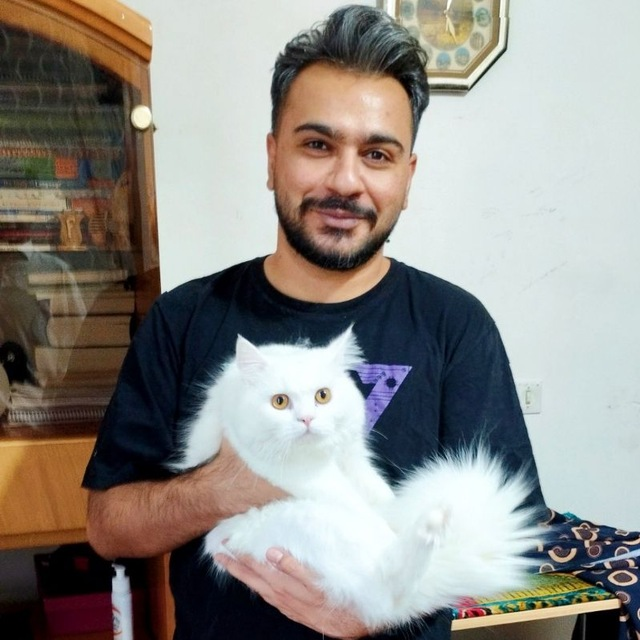

::: {.wrap}

::: {.about-grid}
::: {.portrait}
<figure class="portrait-frame"></figure>

<b>Aref Shahbakhsh</b>
M.Sc. in Computer Engineering 
Department of Computer Engineering, Sharif University of Technology 
Tehran, Iran 
[aref.shahbakhsh@sharif.edu](mailto:aref.shahbakhsh@sharif.edu)

<a class="btn-r" href="https://www.linkedin.com/in/YOUR-LINKEDIN/"><i class="bi bi-linkedin"></i> LinkedIn</a>
<a class="btn-r" href="https://github.com/aref-shahbakhsh"><i class="bi bi-github"></i> GitHub</a>

:::

::: {}
::: {.prose}
I am a machine learning researcher with a background in computer engineering. I completed my M.Sc. in Computer Engineering (Computer Systems Architecture) at Sharif University of Technology in 2024, advised by Dr. Somayyeh Koohi. My thesis, *Prediction of mRNA Subcellular Localization using Deep Learning*, combined a graph neural network over mRNA secondary structure with language-model sequence embeddings to predict localization across five subcellular compartments.

Before that, I earned a B.Sc. in Computer Science at the University of Sistan and Baluchestan, graduating among the top students of my class. My bachelor's thesis, supervised by Dr. M. M. Keikha, earned a grade of 20/20. In 2021 I ranked 152nd (top 1%) among more than 12,000 participants in Iran's national graduate entrance exam in Computer Engineering.

Since my master's I have been studying generative models in depth: VAEs, GANs, and diffusion and score-based models. I am particularly interested in applying them to the generative and predictive modeling of biomolecules, and I am applying to PhD programs to pursue this direction.

Alongside research, I have spent several years as a teaching assistant, from programming fundamentals to bioinformatics, and I enjoy explaining AI to general audiences.
:::

<h2 style="font-size:1.35rem;margin:2.6rem 0 1.2rem">The path so far</h2>
<ol class="path">
<li class="here"><time>2024 –</time>
<b>Independent study of generative models</b>VAEs, GANs, diffusion / score-based models · preparing PhD applications
</li>
<li><time>2021 – 24</time>
<b>M.Sc. in Computer Engineering</b>Sharif University of Technology · Computer Systems Architecture · advised by Dr. S. Koohi · GPA 3.6/4
</li>
<li><time>2019 – 21</time>
<b>Volunteer Software Engineer</b>Taftan Intelligent Programmers · Android development
</li>
<li><time>2016 – 21</time>
<b>B.Sc. in Computer Science</b>University of Sistan and Baluchestan · among the top graduates
</li>
</ol>

<h2 style="font-size:1.35rem;margin:2.6rem 0 1.2rem">Beyond the papers</h2>
::: {.card-grid}
::: {.card}
Chess
<h3>National student chess medals</h3>

Bronze medalist at the National Student Chess Olympiad (2022) with the Sharif team, and gold medalist at the National Student Chess Championship, Region 8 (2018).

:::
::: {.card}
Writing
<h3>Science writing</h3>

Author at Byte Magazine, explaining AI models for a general readership (2025).

:::
::: {.card}
Languages
<h3>Persian and English</h3>

Persian is my native language. I work comfortably in English (TOEFL score on request).

:::
:::
:::
:::

