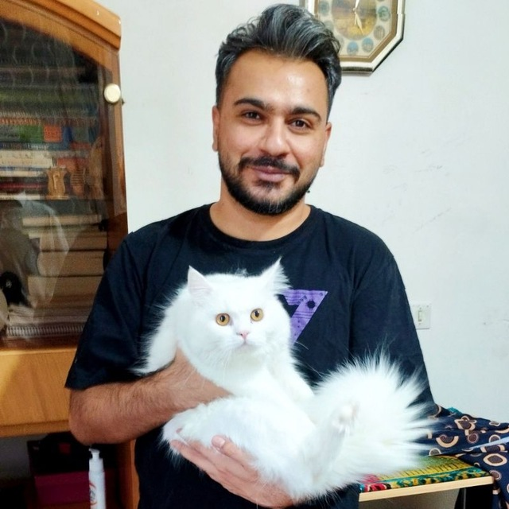

::: {.wrap}
::: {.home-hero}
::: {.hero-text}
<h1>Aref Shahbakhsh</h1>

<b>M.Sc. in Computer Engineering</b> · Sharif University of Technology 

<a class="btn-r solid" href="research.qmd">Research &amp; papers <i class="bi bi-arrow-right"></i></a>
<a class="btn-r solid" href="_assets/documents/Aref_Shahbakhsh_cv.pdf"><i class="bi bi-file-earmark-text"></i> CV (PDF)</a>
<a class="btn-r solid" href="mailto:aref.shahbakhsh@sharif.edu"><i class="bi bi-envelope"></i> Email</a>

<i class="bi bi-geo-alt"></i> Tehran, Iran
<i class="bi bi-mortarboard"></i> <a href="https://scholar.google.com/citations?user=8554euoAAAAJ&hl=en&oi=ao">Google Scholar</a>
<i class="bi bi-github"></i> <a href="https://github.com/Aref-Shahbakhsh">GitHub</a>
<i class="bi bi-youtube"></i> <a href="https://www.youtube.com/@Aref_Piano">Piano channel</a>

:::

<figure class="portrait-arch"></figure>
:::
:::

::: {.band}
::: {.wrap}
::: {.band-head}
<h2>Research Spotlight</h2>
<a class="text-link" href="research.qmd">All research</a>
:::

::: {.theme-grid}
::: {.theme-card}

I.current · 2024 –

<h3>Generative models for biomolecules</h3>

A systematic study of generative models, with the goal of applying them to biomolecules such as DNA, mRNA, and proteins. I am writing a tutorial series that runs from autoregressive models and VAEs to energy-based, score-based, diffusion, and flow-matching models.

<a href="blog.qmd" target="_blank">Tutorial series</a>

:::

::: {.theme-card}

II.2021 – 2025

<h3>mRNA subcellular localization</h3>

A graph neural network over mRNA secondary structure, fused with contextual embeddings from a nucleotide language model, predicts where an mRNA localizes in the cell. This was the focus of my M.Sc. thesis.

<a href="research.qmd#publications" target="_blank">LGLoc</a>

:::

::: {.theme-card}

III.2024

<h3>Antibody paratope prediction</h3>

Predicting which antibody residues bind an antigen by drawing on pretrained antibody and protein language models.

<a href="research.qmd#publications" target="_blank">ParaAntiProt</a>

:::
:::
:::
:::

::: {.band .tint}
::: {.wrap}
::: {.two-col}
::: {}
<h2>News</h2>
<ul class="news">
<li><time>aug 2025</time>Published a tutorial implementing a <strong>neural autoregressive model with Gaussian-mixture conditionals</strong>, with code on GitHub.</li>
<li><time>apr 2025</time>Started a tutorial series on generative models with a post on <strong>variational autoencoders</strong>.</li>
<li><time>spring 2025</time>Wrote as a <strong>science author for Byte Magazine</strong>, explaining AI models for a general readership.</li>
<li><time>2025</time><strong>LGLoc</strong>, a language model-driven graph neural network for mRNA localization, was published in <em>Scientific Reports</em> (co-first author).</li>
<li><time>fall 2024</time>Served as <strong>head of the Artificial Intelligence staff</strong> at the Hardwar event, Sharif University of Technology, and built a <strong>Harry Potter magic wand</strong> with an ESP32 and deep learning.</li>
<li><time>2024</time>Completed my <strong>M.Sc. at Sharif University of Technology</strong>: <em>Prediction of mRNA Subcellular Localization using Deep Learning.</em></li>
</ul>
:::

::: {}
<h2>Selected papers</h2>
<ol class="mini-pubs">
<li><a class="t" href="research.qmd#publications" target="_blank">LGLoc as a new language model-driven graph neural network for mRNA localization</a>S. Akbari Rokn Abadi*, <b>A. Shahbakhsh</b>*, S. Koohi · Sci. Rep. 2025</li>
<li><a class="t" href="research.qmd#publications" target="_blank">ParaAntiProt provides paratope prediction using antibody and protein language models</a>M. Kalemati, A. Noroozi, <b>A. Shahbakhsh</b>, S. Koohi · Sci. Rep. 2024</li>
</ol>

<a class="text-link" href="research.qmd#publications" target="_blank">Full publication list</a>

:::
:::
:::
:::

::: {.band}
::: {.wrap}
::: {.band-head}
<h2>Latest from the blog</h2>
<a class="text-link" href="blog.qmd">All posts</a>
:::

::: {#latest-posts}
:::
:::
:::
